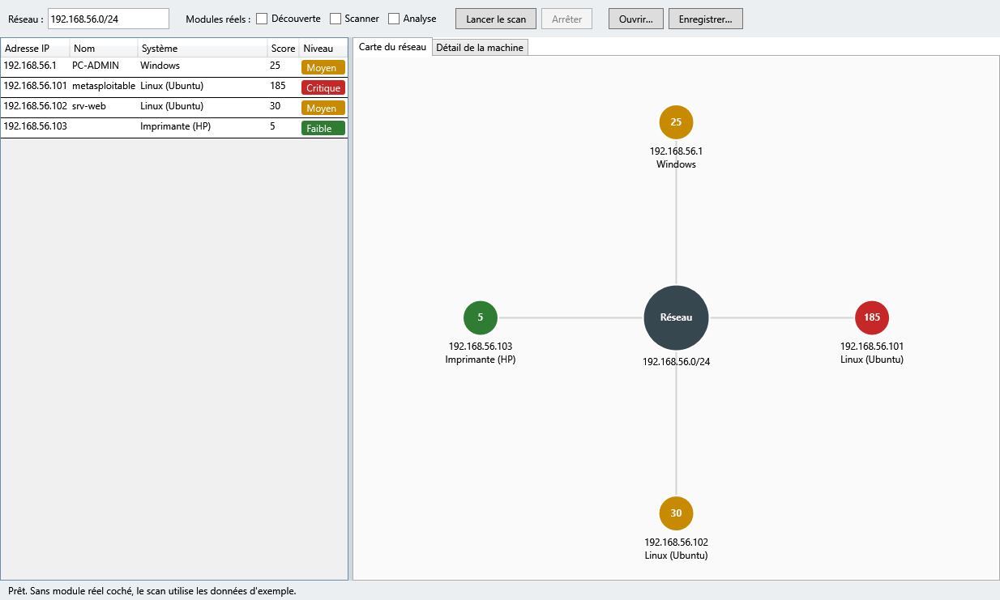

# RiskMap

Inventaire et cartographie réseau, avec recherche de vulnérabilités (CVE) et synthèse par IA.
Projet final C# — .NET 8, interface WPF.



## L'idée de ce squelette

Le projet est une chaîne : **découverte → scan → analyse → affichage**. Normalement chaque étape attend la précédente.
Pour que chacun puisse avancer dès le premier jour sans attendre les autres :

1. **Les données sont définies une fois pour toutes** dans `RiskMap.Core/Models` (Host, Service, Vulnerability…).
2. **Chaque étape est une interface** (`RiskMap.Core/Contracts/Contracts.cs`). Le reste du programme ne connaît que l'interface.
3. **Chaque interface a une fausse version** (`RiskMap.Core/Fakes`) qui renvoie un réseau d'exemple réaliste :
   un poste Windows, une machine Metasploitable 2, un serveur web Ubuntu et une imprimante.

Résultat : l'application tourne déjà de bout en bout avec les fausses données. Chacun remplace **sa** fausse version
par la vraie, et peut la tester tout de suite, même si les autres n'ont pas fini.

## Qui fait quoi

| Module | Dossier | Responsable | Contenu |
|---|---|---|---|
| Découverte | `src/RiskMap.Discovery` | Aida | Ping de toutes les adresses, TTL, adresse MAC et fabricant |
| Carte du réseau | `src/RiskMap.App/NetworkMapControl.*` | Aida | La carte visuelle (une version de départ simple est déjà là) |
| Règles de risque | `rules/port-rules.json` | Aida | Points par port, seuils des niveaux |
| Laboratoire | — | Aida | Réseau de test isolé avec des VM (dont Metasploitable 2) |
| Scanner | `src/RiskMap.Scanner` | Ilyass | Ports ouverts, bannières, devinette du système d'exploitation |
| Application | `src/RiskMap.App` (sauf la carte) | Ilyass | Fenêtre principale, tableau de bord, intégration, relecture des pull requests |
| Analyse & IA | `src/RiskMap.Analysis` | Moi | Bannière → logiciel + version, CVE (NVD + cache), score, synthèse IA |
| Commun | `src/RiskMap.Core` | Tous | Modèles, contrats, données d'exemple. **On ne le modifie pas sans prévenir les deux autres.** |

Dans chaque module, les classes à écrire contiennent des commentaires `TODO` qui expliquent quoi faire et quelles
fonctions .NET utiliser. Elles lancent pour l'instant une `NotImplementedException`.

## Prérequis

- [SDK .NET 8](https://dotnet.microsoft.com/download/dotnet/8.0) (ou plus récent)
- Visual Studio 2022 (charge de travail « Développement .NET Desktop »), ou VS Code / Rider
- Windows (l'interface est en WPF)

## Lancer l'application

Ouvrir `RiskMap.sln` dans Visual Studio, choisir `RiskMap.App` comme projet de démarrage, puis F5. Ou :

```
dotnet run --project src/RiskMap.App
```

Cliquer sur **Lancer le scan** sans rien cocher : tout tourne sur les données d'exemple.
Cocher « Découverte », « Scanner » ou « Analyse » pour utiliser le vrai module correspondant (les autres restent en démo).
Le bouton **Ouvrir** charge un résultat JSON, par exemple `fixtures/3-analyzed.json`.

## Tester sa partie seule (ligne de commande)

L'outil `RiskMap.Cli` lance une seule étape, sur les données d'exemple ou sur une vraie cible :

```
dotnet run --project src/RiskMap.Cli -- discover 192.168.56.0/24        # Aida
dotnet run --project src/RiskMap.Cli -- scan 192.168.56.101             # Ilyass
dotnet run --project src/RiskMap.Cli -- analyze fixtures/2-scanned.json # Analyse
dotnet run --project src/RiskMap.Cli -- run --real scanner              # tout, avec seulement le vrai scanner
```

Ajouter `--out resultat.json` pour enregistrer le résultat (et l'ouvrir ensuite dans l'application).

## Les données d'exemple (`fixtures/`)

| Fichier | Contenu | Sert à |
|---|---|---|
| `1-discovered.json` | Machines trouvées (IP, TTL, MAC) | Entrée du scanner |
| `2-scanned.json` | + ports ouverts, bannières brutes, système | Entrée de l'analyse |
| `3-analyzed.json` | + versions, CVE, score, synthèse IA | Travailler la carte et l'interface |

Ces fichiers sont générés à partir de `RiskMap.Core/Fakes/FakeData.cs`. Pour les régénérer : `dotnet run --project src/RiskMap.Cli -- fixtures`.
Les CVE sont de vraies CVE connues pour ces versions, mais la liste est volontairement courte : ce sont des données de test.

## Organisation Git

- Une branche par personne (`aida`, `ilyass`, la mienne), fusionnée dans `main` par pull request. Ilyass relit et fusionne.
- `main` doit toujours compiler et se lancer.
- Chacun travaille dans son dossier : on ne devrait presque jamais modifier les mêmes fichiers.
- Un changement dans `RiskMap.Core` = on prévient les autres avant, parce que c'est le seul qui peut casser le travail de tout le monde.
- On fusionne **à la fin de chaque semaine**, pas tout à la fin : l'intégration se fait petit à petit.
- Ne jamais pousser de clé d'API. Les clés se lisent dans des variables d'environnement (`NVD_API_KEY`, `RISKMAP_API_KEY`).

## Planning

| Semaine | Objectif |
|---|---|
| 1 | Version de base réelle : découverte, scan des ports, règles, affichage. Carte sur données d'exemple. Test du modèle d'IA local sur la machine de démo. |
| 2 | Bannières et système d'exploitation, recherche des CVE avec cache, score complet, carte branchée sur les vrais résultats. |
| 3 | Synthèse IA, export du rapport, tests sur le laboratoire, préparation de la démo. |

## Cadre légal

On ne scanne que des réseaux qui nous appartiennent ou pour lesquels on a une autorisation. La démo se fait sur le
laboratoire (réseau isolé de VM), jamais sur le réseau de l'école ou un réseau public.

## Structure

```
RiskMap.sln
rules/port-rules.json          Règles de risque (modifiables sans toucher au code)
fixtures/                      Données d'exemple pour chaque étape
src/
  RiskMap.Core/                Commun : Models, Contracts, Fakes, Pipeline, Storage
  RiskMap.Discovery/           Découverte (Aida)
  RiskMap.Scanner/             Scanner + système d'exploitation (Ilyass)
  RiskMap.Analysis/            Bannières, CVE, score, IA
  RiskMap.Cli/                 Outil en ligne de commande pour tester chaque étape
  RiskMap.App/                 Interface WPF (Ilyass) + carte (Aida)
```
